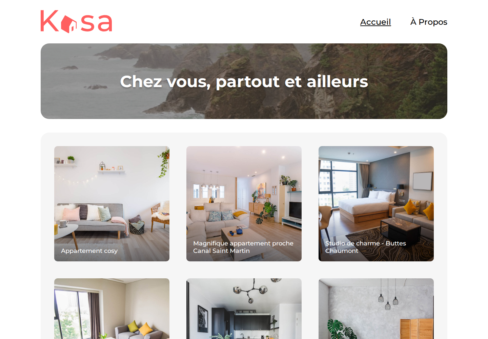

# Kasa

[Français](#français) · [English](#english)

Application web de location de logements entre particuliers (React + Express).

Peer-to-peer housing rental web app (React + Express).

---

## Français

### Contexte

Kasa est une plateforme fictive de location d’appartements, réalisée dans le cadre de la formation **Testeur Logiciel** (OpenClassrooms).  
L’objectif est d’implémenter le front-end en respectant les maquettes Figma et les contraintes du brief, en consommant les données via l’API back-end fournie.

- **Guidelines :** [Coding guidelines Kasa](https://course.oc-static.com/projects/Front-End+V2/P9+React+1/Coding+guidelines+Kasa+FR.pdf)
- **Maquettes :** [UI Design Kasa (Figma)](https://www.figma.com/file/bAnXDNqRKCRRP8mY2gcb5p/UI-Design-Kasa-FR?node-id=4%3A1)

### Stack

- React (front)
- Express (API / données)
- CSS responsive
- React Router

### Fonctionnalités principales

- Page d’accueil avec grille des logements
- Page logement (galerie, tags, notes, collapses)
- À propos
- Page 404
- Layout commun (header / footer)

### Aperçu



### Lancer le projet

```bash
# front
npm install
npm start

# back (selon le brief OC fourni avec le projet)
```

---

## English

### Context

Kasa is a fictional peer-to-peer apartment rental platform, built as part of the **Software Tester** track (OpenClassrooms).  
The goal is to implement the front-end against Figma designs and brief constraints, consuming data from the provided back-end API.

- **Guidelines:** [Coding guidelines Kasa](https://course.oc-static.com/projects/Front-End+V2/P9+React+1/Coding+guidelines+Kasa+FR.pdf)
- **Designs:** [UI Design Kasa (Figma)](https://www.figma.com/file/bAnXDNqRKCRRP8mY2gcb5p/UI-Design-Kasa-FR?node-id=4%3A1)

### Stack

- React (front-end)
- Express (API / data)
- Responsive CSS
- React Router

### Main features

- Home page with housing grid
- Housing page (gallery, tags, ratings, collapses)
- About page
- 404 page
- Shared layout (header / footer)

### Preview


### Run the project

```bash
# front-end
npm install
npm start

# back-end (per the OpenClassrooms project brief)
```
