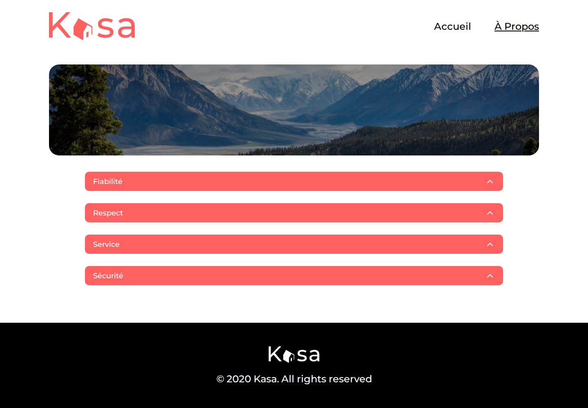

# Kasa

[Français](#français) · [English](#english)

Application web de location de logements entre particuliers (React + Express).

Peer-to-peer housing rental web app (React + Express).

## Français

### Description

Kasa affiche un catalogue de logements. La page d'accueil liste les annonces. Chaque fiche montre la galerie, les tags, la note, l'hôte, la description et les équipements. Le site a aussi une page À propos et une page 404. L'interface est en français.

Maquettes : [UI Design Kasa (Figma)](https://www.figma.com/file/bAnXDNqRKCRRP8mY2gcb5p/UI-Design-Kasa-FR?node-id=4%3A1)

### Stack

- Node.js 26 (version dans `.nvmrc`)
- Interface : React 19, TypeScript, Vite, React Router
- API : Express, Helmet
- Qualité : ESLint avec typescript-eslint (règles type-checked), Vitest, Testing Library, Supertest, Playwright

### Lancer le projet

Il faut Node.js 26.13.0 et npm. Depuis la racine du dépôt :

```bash
nvm use
```

Terminal 1, l'API :

```bash
cd backend
npm ci
npm run dev
```

L'API écoute sur http://127.0.0.1:8080.

Terminal 2, l'interface :

```bash
cd frontend
npm ci
npm run dev
```

Ouvrir http://127.0.0.1:5173. En développement, Vite transmet les requêtes `/api` à l'API locale.

Pour servir un build, lancer l'API puis l'interface. Sans variable `VITE_API_URL` au moment du build, le navigateur appelle `http://localhost:8080`.

```bash
cd backend
npm ci
npm run build
npm start
```

```bash
cd frontend
npm ci
npm run build
npm run preview
```

Vite indique l'URL de preview (port 4173 par défaut).

### Tests

Backend :

```bash
cd backend
npm run lint
npm run typecheck
npm run test:coverage
npm run build
```

Frontend :

```bash
cd frontend
npm run lint
npm run typecheck
npm run test:coverage
npx playwright install --with-deps chromium
npm run test:e2e
npm run build
```

`npm run test:coverage` exécute les tests et échoue si la couverture de lignes descend sous 90 %. Le smoke test Playwright ouvre l'accueil, une fiche, la page À propos et une URL inconnue.

À chaque push sur `main`, GitHub Actions enchaîne le lint, le typecheck, les tests, le seuil de couverture, le build et le smoke test.

### Aperçu





### Licence

MIT

## English

### Description

Kasa shows a housing catalogue. The home page lists the rentals. Each listing page shows the gallery, tags, rating, host, description, and amenities. The site also has an about page and a 404 page. The interface is in French.

Designs: [UI Design Kasa (Figma)](https://www.figma.com/file/bAnXDNqRKCRRP8mY2gcb5p/UI-Design-Kasa-FR?node-id=4%3A1)

### Stack

- Node.js 26 (version pinned in `.nvmrc`)
- UI: React 19, TypeScript, Vite, React Router
- API: Express, Helmet
- Quality: ESLint with typescript-eslint (type-checked rules), Vitest, Testing Library, Supertest, Playwright

### Run the project

Node.js 26.13.0 and npm are required. From the repository root:

```bash
nvm use
```

Terminal 1, the API:

```bash
cd backend
npm ci
npm run dev
```

The API listens on http://127.0.0.1:8080.

Terminal 2, the UI:

```bash
cd frontend
npm ci
npm run dev
```

Open http://127.0.0.1:5173. During development, Vite forwards `/api` requests to the local API.

To serve a build, start the API, then the UI. Unless `VITE_API_URL` is set at build time, the browser calls `http://localhost:8080`.

```bash
cd backend
npm ci
npm run build
npm start
```

```bash
cd frontend
npm ci
npm run build
npm run preview
```

Vite prints the preview URL (port 4173 by default).

### Tests

Backend:

```bash
cd backend
npm run lint
npm run typecheck
npm run test:coverage
npm run build
```

Frontend:

```bash
cd frontend
npm run lint
npm run typecheck
npm run test:coverage
npx playwright install --with-deps chromium
npm run test:e2e
npm run build
```

`npm run test:coverage` runs the tests and fails if line coverage drops below 90%. The Playwright smoke test opens the home page, a listing, the about page, and an unknown URL.

On every push to `main`, GitHub Actions runs lint, typecheck, tests, the coverage gate, the build, and the smoke test.

### Preview


### License

MIT
